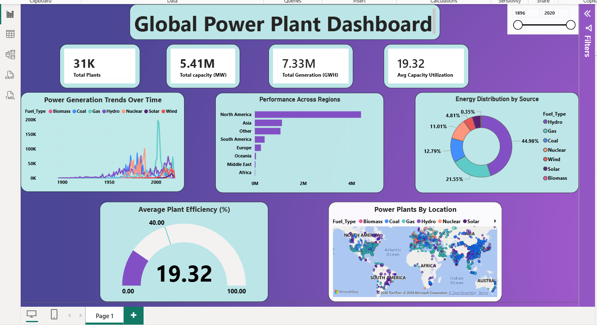

# Global Power Plant Dashboard

An interactive Power BI project exploring **31,118 power plants across 162 countries**. The dashboard examines installed capacity, electricity generation, fuel sources, regional performance, and capacity utilization.

This repository also includes a PowerPoint presentation that summarizes the dashboard and its key findings.

---

## Project at a Glance

| Item | Details |
|---|---|
| Project | Global Power Plant Dashboard |
| Tool | Power BI Desktop |
| Dataset | Global Power Plant Database |
| Records | 31,118 power plants |
| Countries | 162 |
| Dashboard | Single-page Power BI report |
| Presentation | 11-slide PowerPoint deck |

---

## Dashboard Preview



---

## Repository Contents

| File | Description |
|---|---|
| `PowerPlants Dataset.csv` | Original power plant dataset |
| `Powerplants_Dashboard.pbix` | Interactive Power BI dashboard |
| `PowerPlants_dashboard.png` | Dashboard preview image |
| `PowerPlants_Presentation.pptx` | Presentation of the dashboard and key findings |
| `README.md` | Project documentation |

> **Note:** The dataset is embedded in the Power BI file. Open the `.pbix` file with Power BI Desktop.

---

## Dataset Overview

The project uses the **Global Power Plant Database**, cleaned into a single table named `PowerPlants`, containing 31,118 rows.

### Main fields

| Field | Description |
|---|---|
| `Country`, `Country_Code` | Country name and country code |
| `Plant_Name` | Name of the power plant |
| `Capacity_MW` | Installed capacity, measured in megawatts |
| `latitude`, `longitude` | Geographic coordinates of the plant |
| `Fuel_Type` | Primary fuel type, such as solar, wind, hydro, gas, coal, nuclear, or biomass |
| `Start_Year` | Year the plant was commissioned |
| `Owner` | Power plant owner |
| `Generation_GWh` | Electricity generated, measured in gigawatt-hours |
| `Region` | Continent or regional grouping |
| `Capacity_Utilization_Pct` | Percentage of installed capacity used |

---

## Dashboard Overview

The report brings together key performance indicators and interactive visuals to explore the global power plant dataset.

| Visual | Purpose |
|---|---|
| KPI cards | Show total plants, total installed capacity, total generation, and average capacity utilization |
| Line chart | Explore generation trends by commissioning year and fuel type |
| Regional bar chart | Compare electricity generation across regions |
| Donut chart | Show the distribution of generation by fuel type |
| Gauge | Compare average capacity utilization with a 40% target |
| Map | Explore plant locations, with marker size representing capacity |
| Year slicer | Filter the report by commissioning year |

### DAX Measures

The following measures are used in the dashboard:

```DAX
Total Generation (GWH)   = SUM(PowerPlants[Generation_GWh])
Total capacity (MW)      = SUM(PowerPlants[Capacity_MW])
Avg Capacity Utilization = AVERAGE(PowerPlants[Capacity_Utilization_Pct])
Total Plants             = COUNTROWS(PowerPlants)
Max Generation           = MAX(PowerPlants[Generation_GWh])
Fuel Utilization         = AVERAGE(PowerPlants[Capacity_Utilization_Pct])
```

---

## Key Findings

### Overall KPIs

| Metric | Result |
|---|---:|
| Total power plants | 31,118 |
| Total installed capacity | 5,405,310 MW |
| Total electricity generation | 7,331,096 GWh |
| Average capacity utilization | 19.3% |
| Capacity utilization target | 40% |

### Insights from the Analysis

1. **Hydropower leads electricity generation.** It accounts for 45.0% of total generation and 19.5% of installed capacity.
2. **Coal has the largest share of installed capacity.** It represents 36.4% of capacity but contributes 12.8% of generation.
3. **Wind and solar account for 9.3% of generation.** Together, they represent 51% of the power plants in the dataset.
4. **North America contributes the largest share of recorded generation.** Its share is 59.9%, while the USA alone accounts for 54.6%.
5. **Asia has the largest share of installed capacity.** It represents 38.0% of capacity and 15.3% of recorded generation.
6. **The leading fuel source changes over time.** Nuclear and coal led in the 1970s–80s, gas in the 2000s, and wind and solar in the 2010s.
7. **No fuel type reaches the 40% utilization target.** Hydropower is the closest, at 38.4%.

---

## Data Quality Considerations

The dataset contains missing and zero values that should be considered when interpreting the results.

| Data issue | Count | Potential impact |
|---|---:|---|
| `Generation_GWh` is zero | 9,658 (31%) | These records affect the overall utilization result. Plants with reported generation average 28.1% utilization (21,386 plants). |
| `Start_Year` is missing | 16,244 (52%) | The year-based trend and slicer cover only 48% of plants. |
| `Owner` is missing | 13,057 (42%) | Ownership analysis may be incomplete. |
| `Region` is listed as `Other` | 5,188 (17%) | These plants are not assigned to a specific continent. |

### Recommended Improvements

- Keep missing generation values blank rather than automatically replacing them with zero.
- Review source records for large power plants with zero reported generation.
- Map plants listed under `Other` to their correct regions where possible.
- Consider adding a data-quality flag to identify records that should be excluded from selected calculations.

---

## PowerPoint Presentation

The repository includes `PowerPlants_Presentation.pptx`, an 11-slide presentation summarizing the analysis. Speaker notes are included on every slide.

### Slide outline

1. Title
2. Executive summary and KPIs
3. Energy mix by source
4. Installed capacity vs. generation
5. Regional performance
6. Top countries by generation
7. Generation trends by decade
8. Plant efficiency
9. Power plant locations
10. Data quality review
11. Key takeaways and next steps

The charts are editable PowerPoint charts. The map is an image generated from the latitude and longitude data.

---

## How to Use the Project

### 1. Download the repository

Clone the repository or download it as a ZIP file from GitHub.

### 2. Open the Power BI report

Open `Powerplants_Dashboard.pbix` using **Power BI Desktop**.

### 3. Explore the dashboard

- Use the year slicer to filter plants by commissioning year.
- Select chart elements, such as a fuel type in the donut chart, to cross-filter the other visuals.
- Review the KPI cards and charts to explore the dataset.

### 4. Open the presentation

Open `PowerPlants_Presentation.pptx` using Microsoft PowerPoint, Keynote, or Google Slides.

---

## Tools Used

- **Power BI Desktop** — data modeling, DAX measures, and dashboard development
- **Microsoft PowerPoint** — presentation and reporting

---

## Future Enhancements

Potential improvements for a future version of the project include:

- Adding country-level and fuel-level drill-through pages.
- Tracking wind and solar generation share over time.
- Improving the treatment of missing and zero generation values.
- Adding dashboard screenshots to the repository for a visual preview.

---

## Project Summary

This project uses Power BI to explore a global power plant dataset and communicate its key patterns through interactive visuals. It highlights differences between installed capacity and actual generation, compares energy sources and regions, and documents data quality limitations that may affect interpretation.

**Thank you for visiting this project.**
